<picture>
  <source media="(max-width: 600px)" srcset="./assets/nightshift-mobile.4651f9d837.svg">
  
</picture>

  <a href="#selected-builds">Selected builds</a> &nbsp; / &nbsp;
  <a href="#toolbox">Toolbox</a> &nbsp; / &nbsp;
  <a href="https://github.com/Ponpon55837?tab=repositories">All repos ↗</a>

I’m **Upfloor**, a frontend developer building interfaces and tools for working with AI agents.
I like turning everyday friction into small, useful software.

把介面做好，也把與 AI 一起工作的流程做好。

## Selected builds

<a href="https://github.com/Ponpon55837/Squirrel">
  <picture>
    <source media="(max-width: 600px)" srcset="./assets/squirrel-mobile.8d3a6c1c87.svg">
    
  </picture>
</a>

<a href="https://github.com/Ponpon55837/MarioKartWorldParams">
  <picture>
    <source media="(max-width: 600px)" srcset="./assets/mario-kart-mobile.ae489e311e.svg">
    
  </picture>
</a>

<a href="https://github.com/Ponpon55837/Lucky50">
  <picture>
    <source media="(max-width: 600px)" srcset="./assets/lucky50-mobile.dc2126c674.svg">
    
  </picture>
</a>

<a href="https://github.com/Ponpon55837/agent-pets">
  <picture>
    <source media="(max-width: 600px)" srcset="./assets/agent-pets-mobile.b1938ff797.svg">
    
  </picture>
</a>

<a href="https://github.com/Ponpon55837/WorkLog.Ai">
  <picture>
    <source media="(max-width: 600px)" srcset="./assets/work-intelligence-mobile.c20c686458.svg">
    
  </picture>
</a>

<a href="https://github.com/Ponpon55837/agent-pets-plugins">
  <picture>
    <source media="(max-width: 600px)" srcset="./assets/pet-plugins-mobile.9fdd8d0592.svg">
    
  </picture>
</a>

## Toolbox

**Interfaces** &nbsp; `TypeScript` · `JavaScript` · `Vue` · `React` · `HTML` · `CSS`

**Tools & workflows** &nbsp; `Node.js` · `Git` · `MCP` · `AI agents`

Away from the keyboard: good food, online games, and Taiwanese dramas.

 

<picture>
  <source media="(max-width: 600px)" srcset="./assets/next-floor-mobile.5981d2c99a.svg">
  
</picture>

<!-- Original artwork is generated with: node scripts/render-profile.mjs -->
